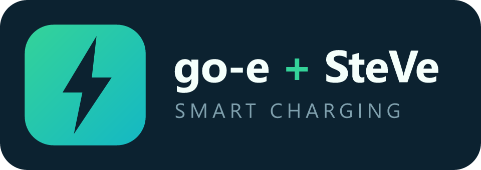

<p align="center">
  
</p>

# go-e + SteVe Smart Charging (Home Assistant)

A HACS custom integration that turns Home Assistant into the **smart-charging brain**
for a [go-e](https://go-e.com) wallbox, while [SteVe](https://github.com/steve-community/steve)
runs alongside as the OCPP backend for authorization and billable metering.

HA regulates charge power by talking to the go-e charger **directly over its native MQTT**
(no separate go-e integration needed), and SteVe owns *"may it charge / how much did it
charge"*. They coexist because the go-e applies the **minimum of all active current limits**.
See [`docs/concept`](#concept) for the full design.

> **Status: early days, actively tested.** All charging modes (solar, price-aware,
> combined), automatic phase switching and the single home-battery reserve line are in
> place, plus SteVe metering (per-RFID kWh, sessions), authorization/remote-control services, and
> **three bundled Lovelace cards** (an answer-strip main card, price-forecast and peak protection). It works on the author's own
> setup, but it's still young and not every wallbox/inverter/price-provider combination has been
> exercised yet. **Try it, and please [open an issue](https://github.com/JustChr/HAgoe_steve/issues)**
> with what worked, what broke, or what you'd like — feedback shapes where this goes next. 🙏

## What it does today

- Reads your existing HA entities (grid power, optional PV / home-battery SoC & power, price) and
  the **go-e charger directly over MQTT** (car state, power, phases, session energy) — it owns the
  wallbox entities, so no separate go-e integration is required.
- It reacts to grid/PV/battery power changes **within seconds** (event-driven, debounced), with a
  30 s poll as a safety net, computing a target charging current and publishing it to the go-e's
  `amp` topic (writes are throttled so it doesn't chase noise); start/stop uses `frc`, phases `psm`.
- **Five modes, one brain:** Smart (solar first + cheap grid + a hard departure guarantee),
  Solar only, Solar + minimum, Fast, and Manual. Under the hood each mode enables a set of
  *strategies* that bid a charging power every cycle; the highest bid drives the charger.
- **One home-battery rule — the reserve line:** a single *"Keep home battery above X %"*
  number. Below the line the battery comes first (all solar fills it, the car gets only
  genuine excess); at/above the line the battery is a **fluctuation buffer** — it bridges the
  seconds the car needs to follow a cloud, and stops holding the current down as soon as the
  dip is over. Sustained discharge into the car is corrected, so the battery never becomes
  the car's power source. 100 % = always protect.
- **No more pointless export:** the charger only takes whole amps, so a surplus never divides
  evenly. Once the home battery is comfortably charged — halfway between your reserve line and
  full — the current rounds **up** to the next amp instead of down, and the last few hundred
  watts come out of the nearly-full battery instead of being exported. Below that mark (and
  always with the reserve at 100 %) it rounds down, so the battery is never asked to lend.
- **Battery-hold for grid charging:** map an optional "stop discharge" switch (e.g. a Victron
  helper) and the brain flips it on whenever it deliberately charges from the grid (cheap
  hours, the departure plan, Fast) so the car draws from the grid instead of draining your
  home battery. Solar surplus still charges the battery. An **Auto / Hold / Free** control (and
  a *Home battery held* sensor) lets you see and override that decision, and the card shows it
  as a shield chip.
- **Peak protection for the 2027 capacity tariff:** Austrian grid operators will bill on the
  **highest 15-minute average grid import** in the month, so one unlucky quarter-hour sets a
  charge that stands until the month ends. The brain measures the *billing* quarter-hour
  (the fixed clock one, :00/:15/:30/:45), projects where it is heading, and holds it under
  your target — easing the wallbox back, and letting the home battery cover more of the
  house. It is a **household** layer: a sauna sets the peak whether or not a car is plugged
  in, so it works with nothing connected at all. **Off by default**, and off means the
  integration behaves exactly as it did before — while the measurement still runs, so you
  can watch your peaks for a month before switching it on. And once a month has already
  peaked higher — the sauna and the oven at the same time, once — it stops throttling below
  a charge you have already bought: the limits float up to just under that peak, close
  enough to use the headroom you paid for and far enough not to push the record higher.
- **Cheap-hour grid charging:** while the price is low, buy energy into the home battery and
  run the house from the grid, filling deep when tomorrow looks dark and stopping early when
  it looks bright so the sun still has somewhere to go. Capped by the peak budget, so it
  imports steadily instead of in the spike that would set a monthly peak — the cheap energy
  without the demand charge.
- **Keep the battery able to shave — cheapest hours first, then any hour:** a pack sitting on
  its floor defends nothing, and in a dark winter week the few cheap hours a day don't keep up
  with the house. Set *Keep ready for peaks above* and the battery is topped up below that
  level whatever the price, because an unshaved quarter-hour costs more than the difference
  between a cheap kilowatt-hour and an ordinary one. It's a floor, not a cap: cheap hours
  still fill deeper. Off by default.
- **Stock up for tonight:** you know tonight is the sauna; the brain doesn't. One switch fills
  the battery toward its target at any price **and holds it there**, so the afternoon's
  ordinary load comes off the grid — far below your limit anyway — instead of quietly spending
  the charge before the evening it was bought for. Filling without holding is the mistake that
  looks like it works.
- **Fast on the knob, slow on the switches:** the surplus is tracked at two speeds. The
  charging **current** follows a responsive signal, so a cloud or a switched-on oven reaches
  the amps within seconds and a clearing sky is used while it lasts. Whether to charge **at
  all**, and on how many **phases**, follows a deliberately calm one — so the fast tracking
  never turns into relay flapping.
- **Calm start/stop ("ride out, then stop"):** a solar start needs ~3 minutes of confirmed
  surplus; a surplus collapse is ridden out for ~5 minutes before a clean stop (with the amps
  still following the live surplus, so a recovery inside the window is used immediately) —
  few, deliberate transitions instead of relay flapping. Impatient? Tap the countdown on the
  card (or press the **Start now** button) to skip the wait — the surplus condition itself
  still has to be met.
- **Mode-aware 1↔3 phase switching** with anti-flap hysteresis, a confirmation window and dwell
  timers: a threshold crossing must hold for ~2 minutes and the contactor moves at most once
  every 5 minutes. Power modes
  (Fast, cheap-grid, deadline charging) use the full phase count, while solar-surplus charging
  prefers a single phase so a small surplus still charges. Enable the **Auto phase** switch —
  phase control (`psm`) is always available over MQTT.
- **Three Lovelace cards:** a main *answer-strip* card — a live charging figure with a ring + source
  bar splitting the car's power into **solar / battery / grid**, a one-line PV/house/grid/battery
  balance, the brain's plain-language reason, chips for state that used to be invisible (battery
  hold, price verdict, dwell countdowns, phases), a plan strip with a **draggable price target**,
  and inline controls (mode, Auto/Hold/Free home battery, the reserve line, the mode's tunables);
  a price-forecast card that plots upcoming prices with a **draggable "cheap" threshold**; and a
  peak-protection card showing the month's billed peak, the live billing quarter-hour against your
  limits, what set the peak, and every setting inline.
- Safety: if the car isn't connected or required data is stale, the brain keeps its hands off;
  turning **Smart control** off returns full manual control of the charger. The one deliberate
  exception is peak protection, which has its own switch: while it is on it keeps managing the
  home battery, and a projected breach of your hard limit still stops the car — a demand charge,
  once bought, cannot be un-bought. Off (the default), it changes nothing at all.

## Installation

1. In HACS → *Integrations* → custom repository, add this repo (category: *Integration*).
2. Install **go-e + SteVe Smart Charging**, restart Home Assistant.
3. *Settings → Devices & Services → Add Integration →* search for it.

**Prerequisites:** Home Assistant's **MQTT** integration set up against your broker, and the go-e
charger connected to that broker with **MQTT enabled and API writes allowed** (go-e app → *Internet
→ Advanced → MQTT*; since firmware 051.5 writes are off by default). No separate go-e integration is
needed — this integration talks to the charger directly.

## Setup

The config flow has three steps:

1. **Energy sources** — grid power (required; + import / − export), optionally PV production,
   home-battery charge level and battery power, an electricity-price sensor, and an optional
   home-battery **hold switch** (turned on to stop the battery discharging while charging the car
   from the grid). The price forecast is auto-detected from the sensor (Nordpool, EPEX Spot,
   EnergyZero, Tibber, …) — leave the override blank unless detection fails.
2. **go-e charger** — the charger's **MQTT base topic** (e.g. `go-eCharger/123456`),
   auto-discovered from your broker so you can pick it from a list, plus grid voltage and phase
   count. The integration then creates the wallbox entities (current, phases, force, car state,
   power, session/total energy, …) itself.
3. **SteVe (optional)** — base URL, an API user + its **API password** (set under *Users* in
   SteVe, not the login password), and an optional default charge box / connector for the
   remote start/stop services. Leave the URL blank to skip — the brain works without it.

Everything can be re-mapped later via the integration's *Configure* (options) dialog.

## Dashboard cards

The integration ships **three** custom Lovelace cards and **registers them automatically** — no
manual dashboard *Resources* entry needed. After setup, edit a dashboard, *Add card*, and pick
them from the card picker (all show a preview). With one Smart Charging device they auto-discover
all entities; if you run more than one, pick the device in the card's visual editor.

**1. Smart Charging card** (`custom:goe-steve-card`) — the main card, an **answer strip**: a big
live charging figure with a ring + source bar showing how much of the charge is **solar / battery /
grid** right now, a one-line balance (PV, house, grid ±, battery ± with SoC vs. the reserve line),
the brain's reason, and chips for the state it used to hide — the **battery-hold shield**, the price
verdict, live dwell countdowns and the phase count. A **plan strip** (Smart mode) shows the price
forecast with the booked cheap windows and a **draggable price target**, and a segmented mode control
plus an **Auto / Hold / Free** home-battery three-way sit below. The session duration ticks live.

```yaml
type: custom:goe-steve-card
# device: <optional — auto-detected when there's only one>
# title: My Wallbox
# show_flow: true       # the source bar + balance line
# show_controls: true
# show_sessions: true
# compact: false        # true hides controls (wall dashboards)
```

**2. Price card** (`custom:goe-steve-price-card`) — an electricity-price forecast chart with a
**draggable "cheap" threshold**: grab the handle and drop it to set the price at/below which grid
power counts as cheap (it writes straight to the *Cheap price* number, no YAML needed).

```yaml
type: custom:goe-steve-price-card
# device: <optional — auto-detected when there's only one>
# title: Electricity price
# hours: 48   # how many hours of forecast to show
```

**3. Peak protection card** (`custom:goe-steve-peak-card`) — what the capacity tariff is going to
bill, and why. The month's **highest quarter-hour** (with the date it happened, and a warning when
the live one is on course to beat it), the billing quarter-hour drawn against your three limits
with the time left in it, a bar per recent quarter-hour so you can see *what* set the peak, the
cheap hours ahead with how deep the battery will be filled in them, and every setting inline.

Give it your grid contract's demand rate and it puts a number on the peak — the integration has no
way to know that, so it lives in the card config.

```yaml
type: custom:goe-steve-peak-card
# device: <optional — auto-detected when there's only one>
# title: Peak protection
# demand_rate: 4.50     # what your operator charges per kW of monthly peak
# currency: "€"
# show_settings: true
```

All three cards are built from one TypeScript + Lit source tree in [`card/`](card/); the bundle is
committed to `custom_components/goe_steve/www/` and rebuilt with
`cd card && npm install && npm run build`.

## Entities created

| Entity | Purpose |
|--------|---------|
| `select` Charging mode | Smart / Solar only / Solar+minimum / Fast / Manual |
| `select` Home battery | Auto / Hold / Free — let the brain decide, always block discharge, or never |
| `switch` Smart control | Master enable — off = hands off entirely |
| `switch` Auto phase | Enable mode-aware 1↔3 phase switching (phase control is always available over MQTT) |
| `number` Min/Max current | Max is the upper bound everywhere; min is the *Solar + minimum* floor and applies in that mode only (elsewhere a charge bottoms out at the EV's 6 A) |
| `number` Keep home battery above | The reserve line (SoC %) — below it the battery comes first, at/above it it buffers for the car; 100 = always protect |
| `number` Car target energy | kWh to deliver by departure (Smart) |
| `number` Cheap price | At/below this price/kWh, grid counts as cheap |
| `button` Start now | Skip the ~3-minute confirmation before a solar start (available only while it runs) |
| `switch` Peak protection | Master enable for the capacity-tariff layer — off = exactly the old behaviour, while the measurement keeps running |
| `switch` Allow up to this month's peak | Stop throttling below a peak the month has already been billed for (on by default) |
| `number` Stay under the month's peak by | How far below that already-billed peak the limits settle (0.2 kW; 0 aims straight at it) |
| `switch` Cheap-hour grid charging | Buy energy into the home battery while the price is low |
| `number` Start easing off at / Peak target / Never exceed | The three limits (kW), compared against the *projected* end-of-quarter-hour average |
| `number` Keep in reserve for peaks | Where the mapped minimum-SoC rests, so ordinary house loads can't drain the battery flat |
| `number` May discharge to for peaks | …and where it drops while shaving — the drop that actually frees the headroom |
| `number` Normal grid import | Your resting ESS grid setpoint (W) |
| `number` Cheap-hour import power | What a cheap hour may import on top of the house load |
| `number` Cheap-hour target, bright/dark day | How deep to fill the battery, chosen by tomorrow's solar forecast |
| `number` Keep ready for peaks above | Below this the battery is topped up at *any* price, so it can still shave (0 = off) |
| `switch` Stock up for tonight | Fill for a big evening and hold it, instead of letting the afternoon spend it |
| `number` Stock-up target | How full that fills the battery (95%) |

All three appear in the peak card's settings block — the first under *Home battery*, the
other two under *Stocking up*.
| `button` Reset this month's peak | Forget the recorded peak when the operator's meter disagrees |
| `sensor` Status | **Plain-language reason** for the current decision |
| `sensor` Surplus for car | Power available under the reserve line |
| `sensor` Target current | What the brain is asking for |
| `sensor` Power flow | Live PV/grid/battery/house/car balance + the car's solar/battery/grid source split (attributes) — drives the card |
| `sensor` This quarter-hour | Average grid import over the **billing** quarter-hour — the control signal, with the projection, budget and limits as attributes |
| `sensor` This month's peak | The highest completed quarter-hour this month: what a capacity tariff actually bills |
| `sensor` Grid power (15 min average) | A plain trailing average, easier to read at a glance |
| `sensor` Peak protection status | **Plain-language reason** for what the peak layer is doing |
| `binary_sensor` Brain controlling / Charging requested | Brain state |
| `binary_sensor` Home battery held | On while the battery is blocked from discharging into the car (the shield chip) |
| `binary_sensor` Peak shaving active | On while the peak layer is intervening; its `tier` attribute (soft/hard) is the hook for your own load-shedding automations |
| `sensor` Active session / Last session energy | SteVe transactions (when configured) |
| `sensor` `{tag} energy` (one per RFID) | Cumulative kWh charged per id-tag |

### SteVe services (when configured)

| Service | What it does |
|---------|--------------|
| `goe_steve.authorize_tag` / `block_tag` | Allow / block an RFID id-tag in SteVe |
| `goe_steve.set_tag_name` | Name an RFID id-tag (`id_tag`, `name`) — stored as its SteVe note and shown everywhere |
| `goe_steve.remote_start` | Start a transaction (`id_tag`, optional `charge_box_id` / `connector_id`) |
| `goe_steve.remote_stop` | Stop a transaction (defaults to the single active session) |

> SteVe's REST API must be enabled and reachable; authentication is HTTP Basic using a web
> user's **API password**. Remote start/stop requires a SteVe build that exposes the
> `remote/start` · `remote/stop` endpoints.

## How it works

The decision logic lives in a pure, HA-free module
([`engine.py`](custom_components/goe_steve/engine.py)): given a snapshot of the world and the
current settings, it returns one decision (target current + phases + a human-readable reason).
The coordinator just reads HA states, calls the engine, and writes the result back — so the
strategy is fully unit-testable.

For a complete, situation-by-situation breakdown of **exactly what the brain does in each mode**
given the price, the home-battery state and the solar surplus, see the
[**Charging behavior matrix**](docs/charging-behavior-matrix.md).

## Development

```bash
pip install pytest
pytest tests/     # engine + SteVe parsing; no Home Assistant install required
```

## Concept

The behavior is specified situation-by-situation in the
[**Charging behavior matrix**](docs/charging-behavior-matrix.md); the direct go-e MQTT
design (topics, key map, verified enum semantics) lives in
[`docs/mqtt-direct-concept.md`](docs/mqtt-direct-concept.md).

## Feedback

This is an early-stage project and feedback is hugely welcome — whether it works great or not.
Please [open an issue](https://github.com/JustChr/HAgoe_steve/issues) with your setup (wallbox,
inverter/battery, price provider), what you tried, and anything that surprised you. Bug reports,
"this mode did X when I expected Y", and feature ideas all help steer the roadmap.

## Roadmap

- **Phase 1 ✅** MVP brain — solar-surplus + manual, Protect policy, safety.
- **Phase 2 ✅** PV+price, price-optimized, combined modes; departure deadlines; automatic phase
  switching; Share/Assist battery policies.
- **Phase 3 ✅** SteVe linkage — per-RFID kWh/transactions, authorization + remote start/stop
  services via the SteVe REST API.
- **Phase 4 ✅** Modern Lovelace card — live energy-flow, reason, inline controls, per-RFID kWh.
- **Phase 5 🚧** Forecast-aware planning & polish — price-forecast card with a draggable cheap
  threshold and a battery-hold switch for grid charging are in; smarter forecast-based planning
  is next.
- **v2.0** The Protect/Share/Assist battery policies and their two thresholds collapsed into a
  single **home-battery reserve line** ("Keep home battery above X %"); existing settings are
  migrated automatically (see the
  [behavior matrix](docs/charging-behavior-matrix.md#migrating-from-v1-protect--share--assist)).
